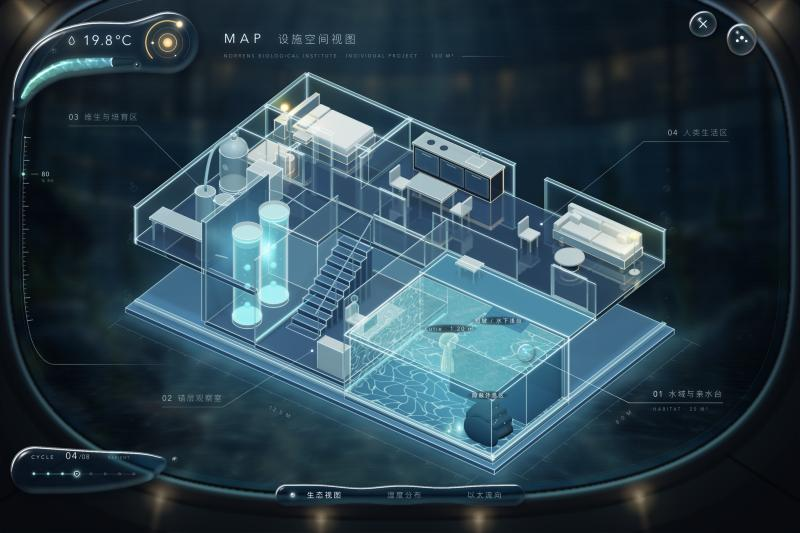

# Lutie · 空间设计工作台

独立的建筑概念网页，使用本地 Three.js 0.170.0。没有框架、构建步骤、在线资源或对原游戏 HUD 的依赖。

从本目录启动 `npm run serve`，打开 `http://127.0.0.1:8767/`。也可通过项目根目录的 HTTP 服务访问 `/design-studio/`。浏览器需要 WebGL；ES 模块需要 HTTP 服务，不能双击 HTML 直接运行。

## 使用

- 总览：默认从西北水池侧俯看，靠近镜头的两面外墙自动剖开，只保留墙脚。拖动旋转、滚轮缩放、右键平移；“默认视角”回到同一构图。
- 顶视：正交平面，拖动平移；点选房间或使用左侧空间索引。
- 剖切：真正裁切三维几何，滑杆移动东西向剖面；规则结构有实体截面填充与标高标注。
- 观察位：眼点固定在观察室地坪上方 1.15m；拖动转头，检查水下视线。
- 左侧可以开关家具、水、设备、玻璃和尺寸，显示人、Lutie、水路关系。
- “外墙避让”跟随总览视角切换前景外墙；关闭该项可保留半高围护。开启“完整墙高”或进入其他视图时自动停用避让，观察位与剖面的实体墙保持完整。
- 右侧调整水位、观察室地坪和亲水台进深；几何、楼梯、尺度人、摄像机眼位和计算值同步更新。
- 参数自动保存在当前浏览器；保存方案下载 JSON，导出模型图下载当前视角 PNG（仅三维模型，不含网页文字标注）。
- 快捷键 1 / 2 / 3 / 4 切视角，Escape 返回总览。右上角可收起侧栏扩大模型。

## 本版取舍

保留现有 MAP 的 12.5×8m 外轮廓及四区分界。内部为 A-01 概念方案：下沉池、通高错层观察室、实际楼梯、可关闭的玻璃分隔、下沉培育井、南侧生活与卫生设施。

初值：池底 −2.20m、水面 −0.15m、观察室 −1.80m、坐姿眼位 −0.65m、湿平台进深 1.25m。湿平台占分区投影 6.5㎡，主池净轮廓水面约 16.65㎡，明确显示与原“约 20㎡ 水池”的取舍。默认半高展示通过裁切实现；完整墙体为 2.8m 层高，观察视角显示顶板。

图纸与几何属于空间讨论模型。房间面积未扣墙体，楼梯、家具、检修通道、门净宽及风水系统尚未经过完整建筑校核。校核提示是本页讨论阈值，不是施工规范合格证明。水路为关系示意，未进行流体或湿度仿真。门扇以开启停靠位置展示。

数据入口：`space.mjs`（尺寸、参数与计算）；`model.js`（三维构件）；`finishes.js`（材质与本地程序纹理）；`contours.js`（发光轮廓线、边缘高光与板材的边缘导光）；`rendering.js`（灯光、透光、反射与画面合成）；`overview.js`（供其他页面嵌入的总览，见下文）；`app.js`（视角、裁切、交互）；`studio.css`（独立页面样式）。

## 模型复盘与材质方向

修正了墙体半高裁切误伤设备封盖、沙发缺扶手、餐椅朝向、床与墙面的间距、厨房阻挡入口等问题。两根培育柱后增加了实体背墙与挡墙。水池具有完整深度、水面法线、水下焦散与剖面填充；设备独立于建筑的半高裁切。

按用户提供的 MAP 参考图，展示方向改为“青色／浅亮黄发光的半实半透建筑概念模型”。参考的是带颜色与厚度的半透明体块、完整而细的亮边、冷暖光色，布局仍使用当前下沉观察方案。抑制电镀式金属反光，同时保留玻璃、水面与轮廓需要的高光。

- 总览与顶视：围护、柜体、座椅、床垫及软包都使用有体积的半透明表现；家具不再以实心日常家居材质呈现。不同透明度构成空间层次，并非所有构件实际使用玻璃。
- 剖面与观察位：围护、柜体与地板恢复实体表现，保留实际玻璃和水的透明，方便检查遮挡与标高。
- 建筑和科研设施使用青色轮廓，生活家具使用浅亮黄轮廓。轮廓由几何统一生成，朝向镜头的边更清楚，远侧边更轻；圆角表面使用同色视角边缘高光。移除了为个别家具手动添加的亮线。
- 薄墙与玻璃只保留中心面的一层轮廓，框架不重复描边；楼板画行走面边界与外露的板厚（埋在相邻楼板里的边由深度遮挡），楼梯画踏面与踢面线。拼缝线仅随图纸尺寸层显示。剖面与顶视保留清晰绘图表现。
- 透光面先采集后方场景，再分别计算着色透光与表面反射；避免通过整体 alpha 同时冲淡颜色和高光。当前为屏幕空间薄面近似，不是多层真实光学仿真。地面写入深度以支持接触暗部；家具透明与灯点亮度分别控制。
- 水纹缓慢变化，隐藏页面或启用系统减少动态效果时停止主动动画。纹理均在本地生成。

### 对照 Koma-1-v4 的质感调整（2026-11-16）

参考图为 `references/game-hud/Koma-1-v4.png`。调整前对模型区域做像素统计：体块底色已接近参考图，差距在画在体块上的光——高亮像素占比 1.8%（参考 7.4%）、锐利边缘占比 3.7%（参考 11.6%）、饱和度 P90 0.66（参考 0.90）。调整后同一统计为 10.5%、10.7%、0.93，亮度中位数 0.35（参考 0.33）。只改总览的表现；几何未动，剖面仍为实体表现。

- 轮廓线：GL 线恒为 1 设备像素，改为按屏幕宽度展开的线段（总览约 1 CSS 像素），叠加发光并参与光晕；剖切墙体的切口处补一圈亮边，切口面本身也发光。
- 板材边缘导光：墙、玻璃、楼板在靠近自身边界和剖切高度处变亮，面中部保持通透；板厚这类“全是边”的面整面发亮。亮度随 `外墙避让` 与 `完整墙高` 的剖切高度变化。
- 绘制顺序：楼板最先，玻璃面靠后，轮廓最后。此前远处家具会被后画的半透明地板盖住而发灰。家具与设备改为写入深度的磨砂浅色实体，不再互相透叠。
- 光晕由单级改为四级（贴线的细晕到大范围的柔晕），阈值提高到只有轮廓、样本、灯和水纹参与；去掉灰青色薄雾，提高饱和度。
- 水体更深更饱和，焦散纹更亮，水面下增加一层反向漂移的细纹；培育柱的介质自发光并有上升的气泡；培育柱玻璃改为普通透明件，可以透过玻璃墙看到。
- ±0.00 的楼板共用一套带镜面反射的材质，反射强度提高到 20–40%。
- 尺度人与 Lutie 改为边缘发光的投影体，Lutie 带一点薄荷色自发光。
- 修正：反射与透光采集时读写同一张纹理导致的 WebGL 反馈回路警告。

未做：底座四角的星芒、背景中的浮游光点与光束（属于游戏画面的环境，接入原型地图时由原型提供）；网页文字标注仍是工作台的标签样式。

### 收敛光感，并嵌入游戏 HUD 的地图（2026-11-17）

嵌入原型地图后，用户反馈“光污染比较严重，玻璃面板太亮”。逐项关闭后测得：亮度主要来自四处——板材边缘导光的宽光带、墙体切口的发光面、轮廓线的青色过饱和、以及大范围光晕；墙面本身并不亮。调整只动这四处，工作台与地图共用同一套数值：

- 轮廓与边缘色由 `#8ce9f3` 改为接近白的 `#b6edf5`；总览的轮廓增益 1.7 → 1.15。
- 边缘导光：贴边的亮线收窄（衰减距离 3 cm → 1.4 cm），向面内渗的光减弱并缩短（15 cm → 9 cm），各材质强度减半。
- 墙体切口：发光面不透明度 0.26 → 0.05，只留切口一圈细线。
- 光晕四级强度 `[.3,.18,.1,.05]` → `[.14,.06,.025,.012]`；合成时不再额外加饱和度（1.18 → 1.0）。
- 样本球自发光 2.6 → 2.1，培育柱介质 0.6 → 0.42。

调整时在地图里实测（与参考图用同一算法，模型区域）：亮部占比 11.1% → 8.3%（参考图 7.8%），饱和度 P90 0.93 → 0.80（参考图 0.89）。此前一节的数字是调整前的状态。

`overview.js` 导出 `createOverview(canvas, { parameters, margin })`，是总览视图的可嵌入版本，供 `prototype/js/map.js` 使用：

- 没有地面和背景。画面在没有画到东西的地方保持透明，模型可以直接叠在宿主页面上；`rendering.js` 为此增加了 `open` 合成模式，透光面板也会保留“后面没有东西”的透明度。
- 机位固定在总览的默认一侧，只允许微倾（`aim(x, y, room)`，约 ±4°／±2°）和向某个房间拉近（1.18 倍）；`step(dt)` 做缓动并返回画面是否移动。
- `project(x, y, z)` 把米制坐标换成画布像素，`roomAt(x, y)` 返回某个像素下的房间（先找楼板，找不到再找房间体积，这样楼板以下的剖面也能点中），`look({ id: 0‥1 })` 点亮房间轮廓，`render(seconds)` 绘制。
- 房间、面积、细部名称都直接来自 `space.mjs` 与 `model.js`，宿主不再另写一份。
- 宿主可以往画面里叠加自己的东西：`floors` 给出每块可行走楼板的顶面（主池给的是水面而不是池底），`her` 是 Lutie 所在的位置，`add(object, onSize)` 把宿主做的三维对象加进场景。原型地图的湿度场和以太流就是这样加上去的（`prototype/js/map-fields.js`），工作台本身不含这两项。

两处实现上的注意：浏览器会直接丢弃“有颜色但透明度为 0”的画布像素，所以开放模式下透明度不低于该点的亮度；最宽的两级光晕多模糊一遍，否则小卷积核的截断会在暗背景上显出一圈硬边。

## 设计咨询与采纳

通过本机的 `model-consult` 技能咨询了配置中的 `proxy:claude-opus-5-5 [perplexity]`。原始答复见 [design-consult-v1.md](design-consult-v1.md)，版本与会话 ID 保留在文件中。渠道答复在 CSS 示例处被截断，原文保持原样。

初版采用了浅色建筑模型、模型优先、四种视角和可追溯参数的方向。后续根据用户参考图与反馈，改为上述半透明模型表现。尺寸模型、三维几何、可移动剖面、规则构件截面、下沉培育井与几何验证由本项目独立实现。咨询中的完整通用校验清单未被当作已完成结果。

## 验证

`npm test` 的 9 项检查已通过，覆盖面积取舍、眼位与水位关系、参数边界、三维水面尺寸、楼梯上下端与不同标高的一致性，以及裁切隔离、家具朝向与边界、设备封盖、入口与厨房净空、培育井背墙和水体剖面。浏览器检查总览、顶视、剖面与观察位；此前也已检查参数变化、轨道控制、外墙随视角避让与默认视角复位。导出下载验证因浏览器权限请求未获批准而停止，未确认最终下载文件。

依赖版权与许可见 `vendor/LICENSE`。
